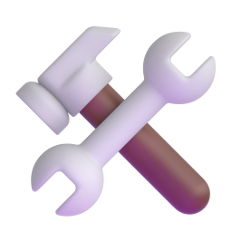
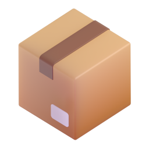
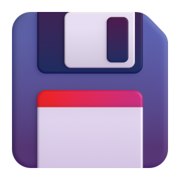

# toaster

A small, fast command-line tool for Windows 11 that shows toast notifications
and plays `.wav` or `.mp3` files. It ships as a single self-contained `toaster.exe`:
drop it anywhere on your `PATH`.

Toasts are sent under the app ID `Soltys.Toaster`, which toaster registers in
`HKCU\Software\Classes\AppUserModelId` on first use. No installer, no admin
rights and no Start Menu shortcut are needed.

## Usage

```
toaster -t "Build done" -b "All green" -i logo.png -s done.wav --wait
```

| Short | Long              | Meaning                                                   |
|-------|-------------------|-----------------------------------------------------------|
| `-t`  | `--title <text>`  | Toast title (optional)                                    |
| `-b`  | `--body <text>`   | Toast body text                                           |
| `-i`  | `--image <path\|name>` | Image file, or the name of an embedded image         |
|       | `--image-style <style>` | `logo` (small, next to the text; default), `inline` or `hero` |
| `-s`  | `--sound <path\|name>` | `.wav`/`.mp3` file, or the name of an embedded sound |
| `-p`  | `--pack <name>`   | Sound pack: play a random sound from `--category`         |
| `-c`  | `--category <name>` | Pack category, e.g. `task.complete`                     |
| `-B`  | `--button <label>` | Add an action button (repeatable, up to 5; needs `--wait`) |
| `-w`  | `--wait`          | Block until the toast is dismissed or clicked             |
|       | `--timeout <sec>` | With `--wait`: give up after this many seconds            |
|       | `--list-embedded` | List sounds and images compiled into the `.exe`           |
|       | `--list-packs`    | List embedded sound packs, their categories and sounds    |
|       | `--list-categories` | With `--pack`: list that pack's categories, one per line |
|       | `--install-skill` | Install the `toaster` AI agent skill (interactive wizard) |
|       | `--skill-target <list>` | With `--install-skill`: `all` or `claude,codex,copilot,vscode,vs`, no questions |
|       | `--print-skill`   | Print the embedded `SKILL.md`                             |
| `-h`  | `--help`          | Show help                                                 |
| `-v`  | `--version`       | Show version                                              |

Values can also be written as `--title=value`.

Without `--title` the toast shows only the body. With neither `--title` nor
`--body`, no toast is shown at all: toaster just plays `--sound` and returns
when it ends (`toaster -s done`). `--image` and `--wait` need a toast.

By default toaster shows the notification and returns immediately. When a
sound is given it returns as soon as the sound has finished playing; the
sound replaces the default Windows notification sound.

With `--wait` it blocks until the toast is resolved. Windows moves an unclicked
toast to Action Center after a few seconds, which also ends the wait.

### Buttons

`-B`/`--button` adds an action button such as OK or Cancel; repeat it for more
(Windows shows at most five, in the order given). Buttons need `--wait`. A toast
with buttons stays on screen until the user answers instead of sliding into
Action Center. When a button is clicked, toaster prints its label to stdout
and exits with 11 for the first button, 12 for the second, and so on. Closing
the toast with X still gives 3, and clicking the toast body still gives 0.

### Exit codes

| Code | Meaning |
|------|---------|
| 0 | Toast shown (with `--wait`: the user clicked it) |
| 1 | Bad arguments, or the image/sound could not be found |
| 2 | Windows refused or failed to show the toast (for example, notifications are turned off) |
| 3 | `--wait`: the user closed the toast |
| 4 | `--wait`: the toast left the screen on its own |
| 5 | `--wait --timeout`: time ran out and the toast was removed |
| 11–15 | `--button`: button 1–5 was clicked (its label is printed to stdout) |

### PowerShell

```powershell
toaster -t "Backup finished" -b "$env:COMPUTERNAME" -s done.wav
toaster -t "Deploy?" -b "Click to confirm" --wait --timeout 60
if ($LASTEXITCODE -eq 0) { ./deploy.ps1 }

$answer = toaster -t "Deploy to production?" -B Deploy -B Cancel --wait --timeout 300
if ($answer -eq "Deploy") { ./deploy.ps1 -Production }
```

### CMD

```bat
toaster -t "Build failed" -b "See build.log" -i error.png -s fail.wav
toaster -t "Ready" --wait
if %ERRORLEVEL% EQU 3 echo Closed by the user

toaster -t "Overwrite files?" -B OK -B Cancel --wait
if %ERRORLEVEL% EQU 11 goto overwrite
```

## AI agent skill

`toaster.exe` carries a ready-to-use agent skill (`skill/toaster/SKILL.md`,
compiled into the `.exe`) that teaches AI coding tools to notify you with
toaster when a long task finishes, fails or needs your input.

```
toaster --install-skill
```

The wizard lists the AI developer tools it finds on this computer, and you
pick one or more by number (Enter installs into every tool found). Each tool
gets the skill in its personal skills folder:

| Tool | Folder |
|------|--------|
| Claude Code | `%USERPROFILE%\.claude\skills\toaster` |
| OpenAI Codex | `%USERPROFILE%\.agents\skills\toaster` |
| GitHub Copilot CLI / Copilot app | `%USERPROFILE%\.copilot\skills\toaster` |
| Visual Studio Code (Copilot agent mode) | `%USERPROFILE%\.copilot\skills\toaster` |
| Visual Studio (Copilot) | `%USERPROFILE%\.copilot\skills\toaster` |

Running it again updates an older copy. In scripts, skip the questions:

```
toaster --install-skill --skill-target all
toaster --install-skill --skill-target claude,codex
```

`toaster --print-skill` prints the embedded skill, for example to commit it to
a repository's `.github/skills/toaster/SKILL.md` or `.claude/skills/toaster/SKILL.md`.

## Building

Requires Visual Studio 2022 (MSVC, C++20) with the Windows 10/11 SDK, and CMake 4.2.3+.

```
cmake --preset msvc-x64
cmake --build --preset release
```

The result is `build/msvc-x64/Release/toaster.exe`, statically linked against
the C/C++ runtime.

### Tests

```
cmake --build --preset release
ctest --preset release
```

`unit` covers the argument parser, packs, embedded asset tables, sound format
detection and the MP3 decoder. `e2e` runs the built `toaster.exe`: exit codes,
error messages, `--list-*`, the embedded skill and `--install-skill` (into a
temporary profile), without showing a toast or playing a sound. Tests that
check the build's own assets skip themselves when it embeds none.

`cmake --preset msvc-x64 -DTOASTER_TEST_UI=ON` adds a `ui` test that does show
real toasts for a second each (exit codes 0 and 5, buttons, image styles) and
plays a silent `.wav`. It needs a desktop session with notifications turned on.

### Embedding sounds and images

Every `.wav` and `.mp3` file in `assets/sounds` and every image (`.png`, `.jpg`, `.jpeg`,
`.gif`) in `assets/images` is compiled into the executable. Drop files into
those folders and rebuild; CMake notices added or removed files on its own.

To use other folders (relative paths are resolved against the repo root):

```
cmake --preset msvc-x64 -DTOASTER_SOUNDS_DIR=C:/my/sounds -DTOASTER_IMAGES_DIR=C:/my/images
cmake --build --preset release
```

Pass an empty value (`-DTOASTER_IMAGES_DIR=`) to embed nothing of that kind.
Subfolders are not scanned.

Each asset is referenced by its file name without the extension, lower-cased,
with anything other than letters, digits and `_` turned into `_`
(`Build-Done.wav` becomes `build_done`):

```
toaster --list-embedded
toaster -t "Build done" -s done -i logo
```

If a file with that name exists in the current directory it is used instead.
Windows only shows toast images from files, so embedded images are unpacked once to
`%LOCALAPPDATA%\toaster\cache`. Embedded sounds play straight from the `.exe`.

#### Downloading icons

`scripts/Get-Images.ps1` downloads 30 ready-made 256x256 PNG icons from
Microsoft's [Fluent Emoji](https://github.com/microsoft/fluentui-emoji)
(MIT licence, the 3D style used by Windows 11) into the images folder, by
default the `msvc-x64` preset's `C:\temp\toast_notification\images`. The
source is pinned to one commit and every file's sha256 is checked; the licence
is saved next to the icons as `fluentui-emoji-LICENSE.txt`.

```powershell
.\scripts\Get-Images.ps1                                   # all icons
.\scripts\Get-Images.ps1 -Name success,failure,warning     # only these
.\scripts\Get-Images.ps1 -List                             # names and what they are for
```

From CMD, use `scripts\get-images.cmd` with the same arguments. Icon names
include `success`, `failure`, `warning`, `info`, `question`, `build`,
`deploy`, `bell`, `waiting`, `done`, `bug`, `robot` and more:

```
toaster -t "Build done" -b "0 errors" -i success
toaster -t "Deploy failed" -b "See deploy.log" -i failure
```

#### All embedded icons

The standard set, as embedded by the `msvc-x64` preset. Use the name with
`-i`/`--image`, for example `toaster -t "Build done" -i success`. The icons are
`docs/icons/*.png` in this repository; the Fluent Emoji licence is next to them.

| Icon | Name | Use | Fluent Emoji |
|:----:|------|-----|--------------|
|  | `success` | Task succeeded | Check mark button |
|  | `failure` | Task failed | Cross mark |
|  | `warning` | Warning | Warning |
|  | `info` | Information | Information |
|  | `question` | Input needed | Red question mark |
|  | `build` | Build | Hammer and wrench |
|  | `deploy` | Deploy / release | Rocket |
|  | `bell` | Generic notification | Bell |
|  | `done` | Finished (hourglass) | Hourglass done |
|  | `waiting` | Still running | Hourglass not done |
|  | `timer` | Timer / duration | Stopwatch |
|  | `alarm` | Reminder | Alarm clock |
|  | `celebrate` | Big success | Party popper |
|  | `trophy` | Achievement | Trophy |
|  | `thumbs_up` | Approved | Thumbs up |
|  | `thumbs_down` | Rejected | Thumbs down |
|  | `stop` | Stopped / blocked | Stop sign |
|  | `fire` | Incident / hot | Fire |
|  | `crash` | Crash | Collision |
|  | `bug` | Bug / test failure | Bug |
|  | `package` | Package / install | Package |
|  | `save` | Saved / backup | Floppy disk |
|  | `locked` |   | Security / permissions Locked |
|  | `settings` | Configuration | Gear |
|  | `computer` | Machine / system | Laptop |
|  | `idea` | Tip / suggestion | Light bulb |
|  | `sparkles` | New / something nice | Sparkles |
|  | `robot` | AI agent / automation | Robot |
|  | `mail` | Message | Envelope |
|  | `coffee` | Break / long wait | Hot beverage |

### Sound packs

The sounds folder can also hold sound pack descriptions: JSON files in the
CESP format (`"cesp_version": "1.0"`), for example `peon.json` or
`glados.json`. Paths inside a pack (`categories.<name>.sounds[].file` and the
optional `icon`) are looked up relative to the JSON file, then by file name in
the JSON folder, in a `<pack>/` subfolder, and (icons only) in the images folder.
Missing files are skipped with a warning. Typical layout:

```
sounds/
  peon.json
  glados.json
  GLaDOS_P2.png
  sounds/
    PeonReady1.wav
    Hello.mp3
    ...
```

#### Downloading packs

`scripts/Get-SoundPacks.ps1` downloads packs from the
[OpenPeon registry](https://github.com/PeonPing/registry) (the peon-ping
packs) into the sounds folder, by default the `msvc-x64` preset's
`C:\temp\toast_notification\sounds`. It checks the sha256 of each pack's
manifest and of every sound, and skips files that are already present and
valid. The script works in Windows PowerShell 5.1 and PowerShell 7.

```powershell
.\scripts\Get-SoundPacks.ps1                               # peon and glados
.\scripts\Get-SoundPacks.ps1 -Name peon,aoe2 -Destination D:\toaster\sounds
.\scripts\Get-SoundPacks.ps1 -List -Name *portal*          # browse the registry
.\scripts\Get-SoundPacks.ps1 -All                          # every pack (large)
.\scripts\Get-SoundPacks.ps1 -Force                        # download everything again
```

From CMD, `scripts\get-sound-packs.cmd` takes the same arguments
(`scripts\get-sound-packs.cmd -Name peon,glados`). The script exits with 1 if
a pack is unknown or a download or hash check fails. Each pack is written as
`<pack>.json` plus a `<pack>\` folder:

```
sounds/
  peon.json
  peon/sounds/PeonReady1.wav ...
  glados.json
  glados/sounds/Hello.mp3 ...
```

Re-run `cmake --preset msvc-x64` afterwards so the new packs get embedded.

#### Building packs in

CMake reads the packs when it configures the build: it checks every file's
`sha256` (a mismatch stops the build), embeds the sounds and the icon, and
compiles the pack names, categories and labels into the `.exe`. Nothing is
parsed at runtime.

```
toaster --list-packs
toaster --pack peon --list-categories
toaster --pack peon --category task.complete
toaster --pack glados -c task.error -t "Build failed" --wait
```

`--pack` plays a random sound from the category. Unless you pass them yourself,
the title is the pack's `display_name`, the body is the sound's `label` and the
image is the pack's `icon`. Pack sounds can also be played directly as
`<pack>_<file name>`, for example `-s peon_peonready1`.
